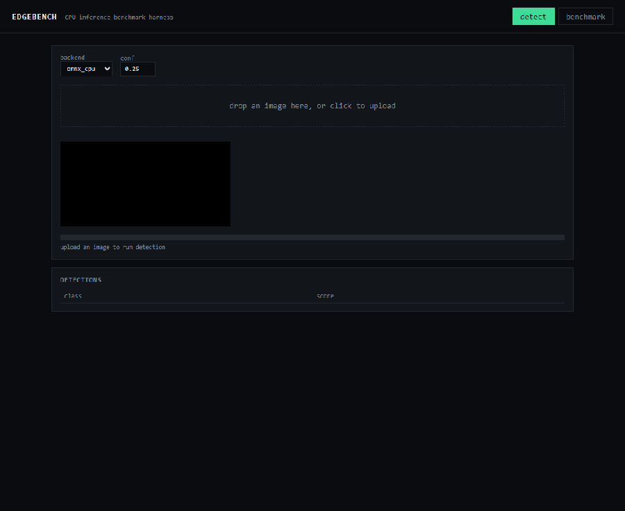
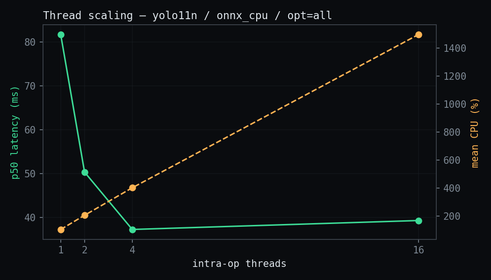
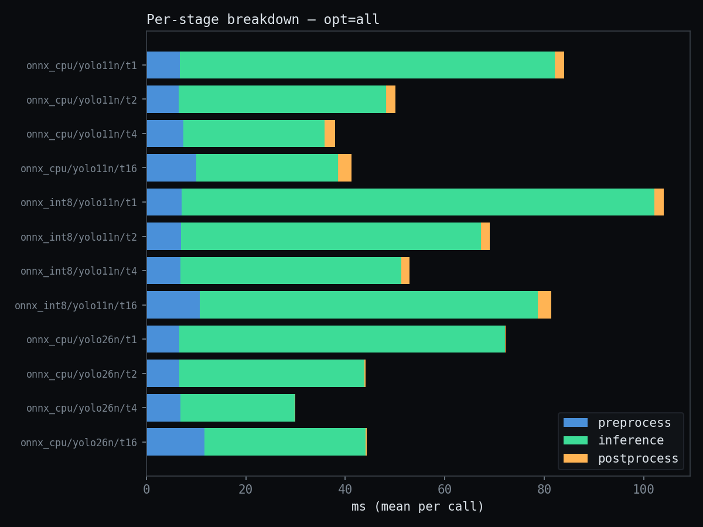

# EdgeBench



Real-time object detection with a rigorous CPU inference benchmark harness for ONNX
Runtime.

**Live demo:** not yet deployed — see [Run it](#run-it) below to run locally or in
Docker.
**CI:** [](https://github.com/Deepak27-00/edgebench/actions/workflows/ci.yml)

## Why this exists

Real-time vision pipelines live or die on tail latency and CPU headroom, not mAP, and
almost no public detection demo publishes either. EdgeBench measures both — percentile
latency, thread scaling, and the fraction of wall time that isn't the model — on
commodity CPU hardware so the methodology is reproducible by anyone, not just on
whatever GPU the author happened to have. It's the CPU-portable sibling of
hardware-accelerated pipeline work done on Qualcomm QCS6490 with GStreamer/QTI
plugins: same discipline (warm-up, percentiles, per-stage breakdown, thread scaling),
applied where anyone can run it.

## Results

All numbers below come from a real, committed benchmark run —
[`results/latest.json`](results/latest.json), generated `2026-09-01T15:28:59Z`,
100 iterations with a 10-iteration warmup discard per configuration. Reproduce it
with `python scripts/run_bench.py`.

**Machine:** AMD64 Family 25 Model 68 Stepping 1, AuthenticAMD · 8 physical / 16
logical cores · Windows 11 · Python 3.12.4 · onnxruntime 1.29.0 ·
CPUExecutionProvider

### Best configuration per model/backend

| Model | Backend | Best config | p50 (ms) | p90 (ms) | p99 (ms) | FPS | CPU % | Peak RSS (MB) |
|---|---|---|---|---|---|---|---|---|
| yolo11n | onnx_cpu | opt=all, t=4 | 37.28 | 44.37 | 48.70 | 26.8 | 402.9 | 174.7 |
| yolo11n | onnx_int8 | opt=all, t=4 | 53.05 | 55.23 | 58.82 | 18.8 | 405.7 | 165.9 |
| yolo26n | onnx_cpu | opt=all, t=4 | 29.72 | 32.97 | 37.94 | 33.6 | 407.3 | 182.3 |

<details>
<summary>Full sweep — 36 configurations (model × backend × graph-opt × threads)</summary>

| Model | Backend | Graph Opt | Threads | p50 (ms) | p90 (ms) | p99 (ms) | FPS | CPU % | Peak RSS (MB) |
|---|---|---|---|---|---|---|---|---|---|
| yolo11n | onnx_cpu | all | 1 | 81.66 | 93.45 | 109.32 | 12.2 | 105.0 | 169.2 |
| yolo11n | onnx_cpu | all | 2 | 50.33 | 53.04 | 56.71 | 19.9 | 206.3 | 174.2 |
| yolo11n | onnx_cpu | all | 4 | 37.28 | 44.37 | 48.70 | 26.8 | 402.9 | 174.7 |
| yolo11n | onnx_cpu | all | 16 | 39.31 | 49.72 | 69.95 | 25.4 | 1498.4 | 177.6 |
| yolo11n | onnx_cpu | basic | 1 | 105.00 | 110.22 | 115.90 | 9.5 | 103.4 | 173.3 |
| yolo11n | onnx_cpu | basic | 2 | 62.28 | 64.92 | 68.84 | 16.1 | 202.1 | 176.8 |
| yolo11n | onnx_cpu | basic | 4 | 43.32 | 47.08 | 55.64 | 23.1 | 404.2 | 177.8 |
| yolo11n | onnx_cpu | basic | 16 | 48.19 | 64.71 | 80.97 | 20.8 | 1505.4 | 180.4 |
| yolo11n | onnx_cpu | disabled | 1 | 104.59 | 110.27 | 130.84 | 9.6 | 101.9 | 176.8 |
| yolo11n | onnx_cpu | disabled | 2 | 62.49 | 67.01 | 69.40 | 16.0 | 205.6 | 176.8 |
| yolo11n | onnx_cpu | disabled | 4 | 43.23 | 46.07 | 51.47 | 23.1 | 399.9 | 178.0 |
| yolo11n | onnx_cpu | disabled | 16 | 56.23 | 86.70 | 113.00 | 17.8 | 1446.5 | 180.7 |
| yolo11n | onnx_int8 | all | 1 | 101.51 | 119.15 | 136.78 | 9.9 | 104.9 | 162.5 |
| yolo11n | onnx_int8 | all | 2 | 67.85 | 76.03 | 82.18 | 14.7 | 204.5 | 167.1 |
| yolo11n | onnx_int8 | all | 4 | 53.05 | 55.23 | 58.82 | 18.8 | 405.7 | 165.9 |
| yolo11n | onnx_int8 | all | 16 | 78.16 | 94.89 | 127.59 | 12.8 | 1475.9 | 169.1 |
| yolo11n | onnx_int8 | basic | 1 | 101.57 | 121.53 | 140.59 | 9.8 | 102.8 | 179.1 |
| yolo11n | onnx_int8 | basic | 2 | 71.47 | 77.58 | 85.67 | 14.0 | 206.7 | 182.3 |
| yolo11n | onnx_int8 | basic | 4 | 56.65 | 62.39 | 68.88 | 17.7 | 404.0 | 181.3 |
| yolo11n | onnx_int8 | basic | 16 | 83.61 | 111.51 | 142.41 | 12.0 | 1470.5 | 185.0 |
| yolo11n | onnx_int8 | disabled | 1 | 96.64 | 101.21 | 107.91 | 10.3 | 103.1 | 180.9 |
| yolo11n | onnx_int8 | disabled | 2 | 68.12 | 73.22 | 77.79 | 14.7 | 206.0 | 181.1 |
| yolo11n | onnx_int8 | disabled | 4 | 56.54 | 66.00 | 75.87 | 17.7 | 406.3 | 181.2 |
| yolo11n | onnx_int8 | disabled | 16 | 80.32 | 103.07 | 123.12 | 12.5 | 1484.3 | 184.5 |
| yolo26n | onnx_cpu | all | 1 | 72.14 | 76.06 | 80.01 | 13.9 | 105.6 | 180.8 |
| yolo26n | onnx_cpu | all | 2 | 43.95 | 48.23 | 49.75 | 22.8 | 200.9 | 181.8 |
| yolo26n | onnx_cpu | all | 4 | 29.72 | 32.97 | 37.94 | 33.6 | 407.3 | 182.3 |
| yolo26n | onnx_cpu | all | 16 | 41.67 | 58.64 | 85.32 | 24.0 | 1435.6 | 184.7 |
| yolo26n | onnx_cpu | basic | 1 | 95.87 | 103.82 | 114.25 | 10.4 | 101.8 | 183.7 |
| yolo26n | onnx_cpu | basic | 2 | 55.38 | 61.68 | 71.90 | 18.1 | 202.3 | 183.4 |
| yolo26n | onnx_cpu | basic | 4 | 37.25 | 39.87 | 43.01 | 26.8 | 401.1 | 182.8 |
| yolo26n | onnx_cpu | basic | 16 | 49.88 | 84.39 | 113.27 | 20.0 | 1428.9 | 182.8 |
| yolo26n | onnx_cpu | disabled | 1 | 91.52 | 99.04 | 104.90 | 10.9 | 102.4 | 182.9 |
| yolo26n | onnx_cpu | disabled | 2 | 62.27 | 80.57 | 95.95 | 16.1 | 199.6 | 183.0 |
| yolo26n | onnx_cpu | disabled | 4 | 42.35 | 50.49 | 55.92 | 23.6 | 402.3 | 183.4 |
| yolo26n | onnx_cpu | disabled | 16 | 45.69 | 53.23 | 68.20 | 21.9 | 1496.9 | 185.6 |

`onnx_int8/yolo26n` is absent: no INT8 export was produced for yolo26n (see
[Known limitations](#known-limitations)).
</details>

### Thread scaling — latency vs. CPU cost



### Per-stage breakdown



## Findings

- **YOLO26's NMS-free head measurably wins, but not by the vendor's margin.**
  yolo26n beats yolo11n at each backend's best configuration (opt=all, 4 threads):
  **29.72ms vs 37.28ms p50 — a 20.3% reduction**. Both models find the same 5
  objects on the sample image (`assets/sample.jpg`) with box coordinates matching
  to within a few pixels — the postprocessing changed, not the detections.
  Ultralytics publishes ~43% on their own hardware; this is the number this repo
  actually measured on a Ryzen laptop CPU, not theirs — the gap is worth noting
  rather than smoothing over, and likely reflects differences in CPU
  microarchitecture, thread count, and image content rather than a reproduction
  failure.
- **The NMS-free head's win is concentrated in postprocessing, not just the graph.**
  Mean postprocess time drops from 2.11ms (yolo11n: transpose 8400 anchors, decode,
  class-wise NMS) to 0.17ms (yolo26n: confidence filter + un-letterbox only) — a
  **92.1% reduction**. Almost no public benchmark separates "faster graph" from
  "postprocessing disappeared"; this harness does, because it times preprocess,
  inference, and postprocess independently for every backend.
- **INT8 dynamic quantisation is a genuine negative result here.** At every
  thread count, `onnx_int8` is slower than fp32 `onnx_cpu` — +24.3% at 1 thread,
  +42.3% at 4 threads, +98.8% at 16 threads. Dynamic quantisation only quantises
  weights; activations still run in float, and YOLO11 is convolution-dominated, so
  the dequantise/requantise overhead on every conv outweighs the smaller weight
  footprint. This is the expected outcome for this technique on this architecture,
  not a bug — reported honestly rather than omitted.
- **Threading doesn't parallelize the whole pipeline, only the model.** As
  intra-op threads go from 1 → 4, yolo11n's inference time drops from 75.4ms to
  28.5ms, but preprocess/postprocess stay roughly flat (~9ms combined). The result:
  the fraction of wall time spent outside the model climbs from **10.3% at 1
  thread to 25.0% at 4 threads to 31.2% at 16 threads** — the more you optimise the
  model, the more the surrounding pipeline dominates. This is the same lesson as
  moving GStreamer stages off CPU one at a time: whichever stage you didn't move
  becomes the new bottleneck.
- **Graph optimisation matters more than it gets credit for.** `graph_opt_level`
  alone (all vs. disabled, both at 4 threads) is worth a 13.8% latency reduction
  on yolo11n — free, with no accuracy cost, and frequently left at its default
  by demos that never sweep it.

## Methodology

- **Warmup discard.** Each configuration runs 10 untimed warmup inferences before
  the first timed sample. First-call cost includes lazy ONNX graph initialisation
  and allocator warm-up (visible as a multi-x outlier if included) — this is the
  single most common benchmarking error, and excluding it is not optional here.
- **Percentiles, not just means.** p50/p90/p99 are reported because tail latency,
  not average latency, is what breaks a real-time pipeline's frame budget.
- **Per-stage timing.** Every backend implementing the `Detector` protocol exposes
  `preprocess_ms` / `inference_ms` / `postprocess_ms` for its most recent call, so
  the harness can attribute wall time rather than treat inference as the whole cost.
- **Resource sampling.** Process CPU% and RSS are sampled on a background thread at
  ~20Hz across the entire timed window (not just at one instant), then reduced to
  mean CPU% and peak RSS.
- **Environment capture.** CPU model, physical/logical core counts, OS, Python,
  onnxruntime version, and the active execution provider are recorded with every
  result — a latency number without machine context is not reproducible.
- **What is not controlled for:** single machine, no thermal throttling control, no
  isolation from other processes on the host, one sample image (a street photo with
  a bus and three to four people — not a COCO-val-scale sample). Thread counts above
  the physical core count (16 logical on an 8-core/16-thread CPU) measure
  hyperthreading contention, not pure parallel scaling, and are reported as such
  rather than treated as free additional throughput.

### Known limitations

- **320px input size was not benchmarked.** The exported ONNX graphs have a static
  640×640 input (`dynamic=False` at export); a 320 sweep would need its own export
  and was cut as explicitly optional in the build plan rather than faked by
  resizing into a 640 graph.
- **No INT8 export for yolo26n.** Only `yolo11n.int8.onnx` was produced; the
  `onnx_int8` row is absent for yolo26n in the results rather than estimated.
- **`torch_ref` backend is an empty stub.** The `Detector` protocol and backend
  registry support a PyTorch reference backend for local A/B comparison, but no
  reference implementation was written — it wasn't part of what got measured, so
  it isn't claimed as a backend in the results.
- **Docker deployment is locally verified, not publicly deployed.** The image
  starts successfully with `docker run --rm -p 7860:7860 edgebench:local` and
  serves the web app and `/healthz`. A production host still needs appropriate
  CPU/RAM, request limits, and a public source link that matches the deployed
  AGPL-3.0 version.
- **Not yet deployed.** No live demo URL exists yet — see [Run it](#run-it).

## Run it

```bash
# local
pip install -r requirements-dev.txt
python scripts/export_model.py            # writes models/yolo11n.onnx (once)
uvicorn app.main:app --reload --port 8000

# docker
docker build -t edgebench:local .
docker run --rm --name edgebench-local -p 7860:7860 edgebench:local
# Verify in another terminal: http://localhost:7860/healthz
# Inspect the container health: docker inspect --format='{{.State.Health.Status}}' edgebench-local

# benchmark
python scripts/run_bench.py               # writes results/<timestamp>.json + results/latest.json
```

Runtime dependencies in `requirements.txt` are pinned to the versions verified
in the local Docker image. Rebuild the image after changing these dependencies
and confirm `/healthz` reports `healthy` before deployment.

## Architecture

```
app/
├── main.py              # FastAPI app, routes, lifespan-managed model loading
├── schemas.py            # pydantic request/response models
└── static/index.html     # single-file UI: detect tab + benchmark tab, inline SVG charts
edgebench/
├── detector.py            # Detection dataclass + Detector protocol + COCO classes
├── preprocess.py          # letterbox resize/normalise + inverse transform
├── postprocess.py         # anchor decode + NMS, and NMS-free decode, behind one dispatcher
├── backends/              # onnx_cpu, onnx_int8 — one registry, pluggable by name
└── bench/                 # harness.py (percentiles, resource sampling), report.py
scripts/
├── export_model.py        # ultralytics -> ONNX (dev only)
├── quantize.py             # dynamic INT8 quantisation (dev only)
└── run_bench.py            # sweeps the matrix, writes results/*.json
```

Every backend — `onnx_cpu`, `onnx_int8`, and any future one — implements the same
`Detector` protocol: `warmup(n)`, `infer(img, *, conf_thres=None)`, and a
`stage_timings` property. Neither the API layer nor the benchmark harness know or
care which backend they're driving; `edgebench/backends/__init__.py`'s `BACKENDS`
registry is the only place a new backend gets wired in. That's what made it possible
to add a second model family with a structurally different output layout — YOLO26's
NMS-free `(1, 300, 6)` head vs. YOLO11's anchor-based `(1, 84, 8400)` head — without
touching the API or the harness at all: `postprocess.decode()` branches on the
output shape internally, so the backend and everything upstream of it are unchanged.

The served app depends on **onnxruntime only** — `ultralytics` and `torch` are
dev-only extras (`requirements-dev.txt`) used to export models and would otherwise
pull in a multi-hundred-MB PyTorch install and AGPL-3.0-licensed code into the
runtime image, for a job (running an already-exported ONNX graph) that doesn't need
either.

## Licensing and source availability

This repository is distributed under the [GNU Affero General Public License v3.0](LICENSE)
(AGPL-3.0). It includes exported model files derived from Ultralytics YOLO11 and
YOLO26 pretrained weights: `models/yolo11n.onnx`, `models/yolo11n.int8.onnx`, and
`models/yolo26n.onnx`. The INT8 model is a dynamically quantised derivative of
`yolo11n.onnx`; export or quantisation does not remove the model's licence terms.

See [THIRD_PARTY_NOTICES.md](THIRD_PARTY_NOTICES.md) for model attribution,
licensing links, and deployment obligations. This project is intended for public,
open-source learning and benchmarking. A network deployment must provide the
matching complete source under AGPL-3.0. Private, proprietary, commercial, or
embedded use of these models may require an Ultralytics Enterprise licence.

The runtime image contains no Ultralytics source
code — only the exported ONNX graphs and onnxruntime to execute them.
